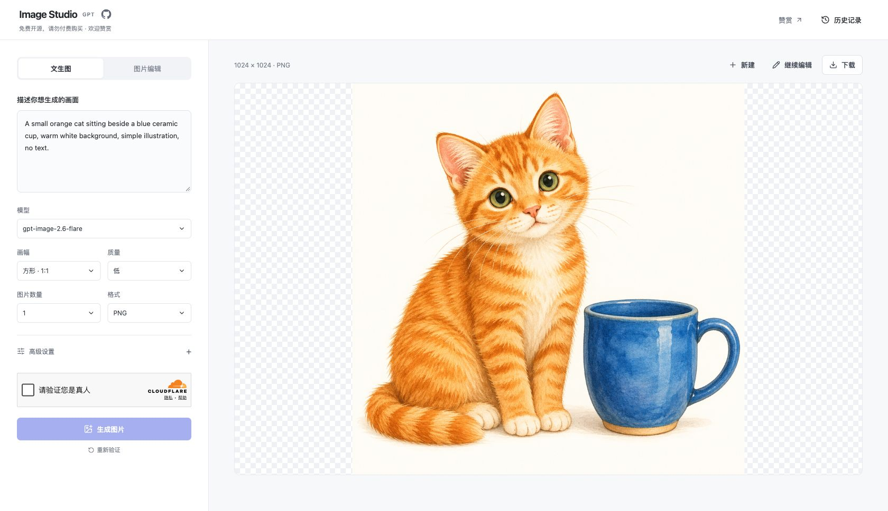

<h1 align="center">GPT Image Studio</h1>

Generate and edit images with GPT Image, with streaming previews, local history, and deployment on Cloudflare.

  

<a href="README.md">简体中文</a> · English

  <a href="https://image.cansiny.top">Try it online</a> ·
  <a href="docs/usage.en.md">Usage guide</a> ·
  <a href="docs/hosting.en.md">Development &amp; deployment</a> ·
  <a href="https://github.com/Cansiny0320/gpt-image-studio/issues">Report an issue</a> ·
  <a href="#support">Support</a>

## Try it online

Visit [image.cansiny.top](https://image.cansiny.top) and enter a prompt to generate an image. No account or personal API key is required.

Generate images from text, edit reference images, upload mask or markup PNGs, generate up to three images per request, and watch streaming previews. Available size, quality, background, output format, and advanced settings depend on the selected model.

See the [reference image editing example](https://image.cansiny.top/guide#reference-edit-example) for the original image, full prompt, and result.

Download a result or use it for another edit. History stays in your browser, including full prompts, settings, and images, with ZIP export and import.

## Feedback

Open an [issue](https://github.com/Cansiny0320/gpt-image-studio/issues) with reproduction steps, your browser, the selected model, and the error message. Do not include API keys, private prompts, or images.

## Support

If you find this project useful, you can support it through WeChat Pay or Alipay. The same QR codes are available on the website's [support page](https://image.cansiny.top/sponsor).

